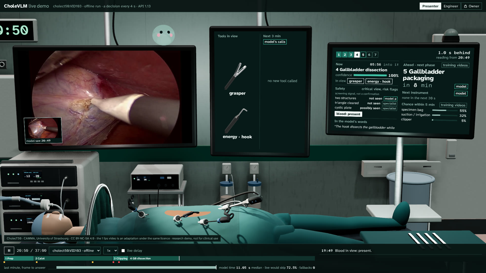
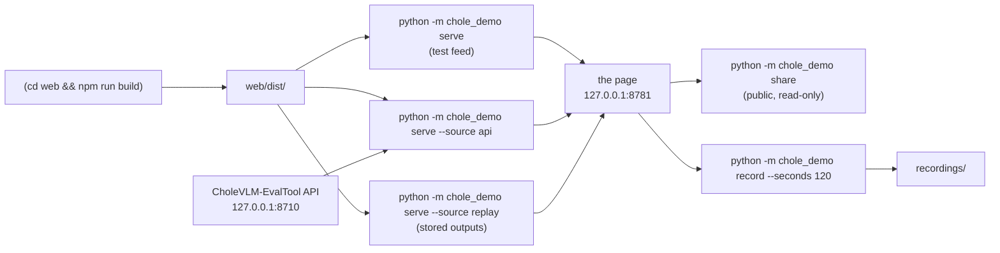

# CholeVLM-DemoPublic

- **What it does:** serves a web page, a 3D operating room that plays a surgical video on one monitor and shows the model's output at each time step on the others, read from the API of the [evaluation and serving repository](https://github.com/KTLin8672/CholeVLM-EvalTool).
- **What it never does:** it binds nothing but 127.0.0.1, and it serves nothing about the machine or the people who run it.
- **Related repositories:** [CholeVLM-DataTool](https://github.com/KTLin8672/CholeVLM-DataTool), the data repository, builds the training data; [CholeVLM-TrainingTool](https://github.com/KTLin8672/CholeVLM-TrainingTool), the training repository, trains the model; [CholeVLM-EvalTool](https://github.com/KTLin8672/CholeVLM-EvalTool), the evaluation and serving repository, serves the model, and its API is this repository's only input; [CholeVLM-ControlTower](https://github.com/KTLin8672/CholeVLM-ControlTower), the planning repository, holds the plan and the decision log.



- **In the picture:** the page as a visitor sees it, 20 min 50 s into CholecT50's video VID103. The video's frame is CholecT50's (CAMMA, University of Strasbourg), under CC BY-NC-SA 4.0, and so is this picture.

## How it runs



## Before you start

- **Tested on:** Ubuntu 24.04 on an aarch64 machine; no GPU is needed, since the 3D room is drawn by the viewer's browser
- **Needs:** Python 3.12, Node.js 22 with npm, and `ffmpeg` (it makes the test feed's video)
- **Optional:** a systemd user session (`systemd-run --user`) for the `tenant` command and the services; the ngrok agent with an authtoken (`ngrok config add-authtoken TOKEN`) for `share`
- **Where the input comes from:** this copy carries the model's stored outputs for two validation videos, and you bring the videos from your own copy of the datasets (see Replay below). Run live, the model's outputs and the videos come from the API of the [evaluation and serving repository](https://github.com/KTLin8672/CholeVLM-EvalTool), started there with `python -m chole_eval.serve api --no-model` on `127.0.0.1:8710` (see [its README](https://github.com/KTLin8672/CholeVLM-EvalTool/blob/main/README.md)). The test feed needs nothing.

## Set up

- **A virtual environment**, then the pinned packages, this repo, the browser for the page tests and recordings, and the page's JavaScript packages

```bash
python3.12 -m venv .venv
source .venv/bin/activate
pip install -r requirements.txt -r requirements-dev.txt    # requirements-dev.txt: the tests and the linter
pip install -e .
PLAYWRIGHT_BROWSERS_PATH=$VIRTUAL_ENV/ms-playwright python -m playwright install chromium   # kept inside .venv
(cd web && npm ci)
```

- **The one file you edit:** `configs/api.local.yaml`, and only if the API of the [evaluation and serving repository](https://github.com/KTLin8672/CholeVLM-EvalTool) is not at `127.0.0.1:8710`: `cp configs/api.local.example.yaml configs/api.local.yaml`, then change `endpoint:`. Optional: `configs/tenant.local.yaml` (see the `tenant` command below). Both are gitignored.
- **For the `tenant` command**, if a training job from the [training repository](https://github.com/KTLin8672/CholeVLM-TrainingTool) runs on the same machine: `export ARTIFACT_ROOT=DIR`, where DIR is the folder the training repository writes its status file under, or `training_status:` in `configs/tenant.local.yaml`
- **The password for asking the model:** visitors to the public page can only watch. The demo's administrator runs `python -m chole_demo owner-password` and types a password twice at the prompt (it is not shown); then, on the page, they open the Owner tab and type it there to get the Ask box.

## First run

- **The page on the test feed**, under a minute: build the page, then serve it and leave the server running

```bash
(cd web && npm run build)      # success: ends with "built in" and a time
python -m chole_demo serve     # success: "Uvicorn running on http://127.0.0.1:8781"; the first answer takes about 15 s
```

- **In a second terminal:** success is `up`; then open `http://127.0.0.1:8781` in a browser and the operating room plays a test pattern under the banner "MOCK FEED, made-up decisions"

```bash
curl -sf http://127.0.0.1:8781/api/videos >/dev/null && echo up
```

## Replay

- **Stored outputs, no model:** `replay/` holds what the model said, second by second, over two validation videos, CholecT50's VID103 and Cholec80's video 46, as the live demo shows them. The page replays them; nothing is computed.
- **The videos are yours to bring:** the datasets' licence lets the demo show their frames but not hand them out, so this repository carries none. Get Cholec80 and CholecT50 from CAMMA (University of Strasbourg), then make each video's picture once from your copy, either the folder of its 1 fps frames or its video file:

```bash
python -m chole_demo.feeds.replay cholect50:VID103 /path/to/VID103-frames/   # numbered PNG or JPEG, one a second
python -m chole_demo.feeds.replay cholec80:46 /path/to/video46.mp4           # or the video file, read once a second
python -m chole_demo serve --source replay    # success: http://127.0.0.1:8781 plays VID103 with the model's outputs
```

- **The format**, for a picture or outputs made another way (VIDEO is the video id with `:` as `_`):
  - `runs/replay/video/VIDEO.mp4`: H.264, one frame a second, frame t being second t of the operation, 644×392;
  - `runs/replay/frames/current/VIDEO/TTTTT.jpg` at 644×392 and `runs/replay/frames/video/VIDEO/TTTTT.jpg` at 336×196: second T as a JPEG, numbered from 00000;
  - `replay/VIDEO.json`: one video's outputs as the page reads them from `GET /api/rollout` (`meta`, `decisions` with each decision's second in `t_frame`, `dropped`, `end`); the two files there are the example, and another in the same form is listed beside them.
- **Licence and differences:** the outputs describe the two videos and come under their licence, CC BY-NC-SA 4.0, for research and not for clinical use. The picture is the dataset's whole frame, scaled and letterboxed, where the model saw it cropped to the endoscope's view; asking the model answers that no model is connected.

## Run

| Command | What it does | Output |
| --- | --- | --- |
| `(cd web && npm run build)` | Builds the page, replacing `web/dist/`; a running server serves the new build at once. Needs `npm ci` first. | `web/dist/` |
| `python -m chole_demo serve` | Serves the page on a test feed of made-up decisions, writing the feed to `runs/mock/` at its first request; needs no API. | `http://127.0.0.1:8781` |
| `python -m chole_demo serve --source api` | Serves the page on the model's outputs over the demo videos; needs the API of the [evaluation and serving repository](https://github.com/KTLin8672/CholeVLM-EvalTool) running. | `http://127.0.0.1:8781` |
| `python -m chole_demo serve --source replay` | Serves the page on the model's stored outputs in `replay/`, with no model; each video's picture made first (see Replay). | `http://127.0.0.1:8781` |
| `python -m chole_demo.feeds.replay VIDEO_ID PATH` | Makes a video's picture under `runs/replay/` from your own copy of it: a folder of its 1 fps frames or its video file. | `runs/replay/` |
| `python -m chole_demo share` | Runs ngrok in front of port 8781, so anyone with the address can watch; needs a server on 8781. | the public address, in its log |
| `python -m chole_demo record --seconds 120` | Renders the page served on port 8781 frame by frame in headless Chromium into a video; refuses to record over one of the same name unless given `--replace`. | `recordings/*.mp4` and a JSON file beside each |
| `(cd web && npm run dev)` | Serves `web/` with hot reload while you edit it, taking its data from the server on port 8781; stop it when you are done. | `http://127.0.0.1:5173` |
| `python -m chole_demo bake-instruments` | Draws the surgical instruments' pictures from their 3D models, replacing the committed files; needs port 5173 free. Commit them. | `web/public/instruments/*.webp` |
| `python -m chole_demo tenant -- CMD` | Runs CMD with capped CPU and memory, so a training job on the same machine keeps its speed. | CMD's output, between two lines on the training job |

- **The `tenant` command:** run the browser tests, recordings and pictures through it when a training job shares the machine (Set up says how it finds that job). Its limits, and when it stops CMD with exit code 75, are in [`src/chole_demo/tenant.py`](src/chole_demo/tenant.py).
- **Always on:** two user services. `chole-demo-screen` serves the page from the evaluation and serving repository's API on port 8781, and `chole-demo-share` runs ngrok in front of it. In both files under `deploy/`, first set `WorkingDirectory=` to your clone and the python in `ExecStart=` to `.venv/bin/python` there.

```bash
cp deploy/*.service ~/.config/systemd/user/ && systemctl --user daemon-reload
systemctl --user enable --now chole-demo-screen chole-demo-share   # chole-demo-share makes the page public at once
systemctl --user restart chole-demo-screen     # after a change under src/; a change under web/ needs none
```

- **The API the page reads is not one of them** and does not start again after a reboot: until it runs, the page loads with no video and the check under Check prints nothing. Start it from the evaluation and serving repository's folder, with its environment active; if systemd says the unit already exists, run `systemctl --user reset-failed chole-eval-api-nomodel` first.

```bash
systemd-run --user --unit chole-eval-api-nomodel --same-dir -E ARTIFACT_ROOT -E DATA_ROOT "$(command -v python)" -m chole_eval.serve api --no-model
```

- **Ship a change to the page:** build into a trial folder, test it, and swap it in only if the tests pass; the last line says which happened

```bash
TRIAL=$(mktemp -d); BACKUP=$(mktemp -d)
if (cd web && npx vite build --outDir "$TRIAL" --emptyOutDir) && [ -f "$TRIAL/index.html" ] &&
   CHOLE_DEMO_TEST_DIST="$TRIAL" python -m chole_demo tenant -- python -m pytest -q tests/test_screen.py
then rsync -a web/dist/ "$BACKUP"/ && rsync -a --delete "$TRIAL"/ web/dist/ && echo "SWAPPED: the old page is in $BACKUP"
else echo "NOT SWAPPED: the build or its tests did not pass; the live page is unchanged"
fi
```

- **Roll back** to the previous page, in the same terminal, only if the live page is wrong; it does nothing unless the swap above saved the old page

```bash
if [ -n "$BACKUP" ] && [ -f "$BACKUP/index.html" ]
then rsync -a --delete "$BACKUP"/ web/dist/ && echo "ROLLED BACK: the old page is live"
else echo "NOT ROLLED BACK: no page was saved by a swap in this terminal"
fi
```

## Check

- **Healthy:** the tests that need no browser, and the linter

```bash
python -m pytest -q --ignore=tests/test_screen.py && ruff check .    # healthy if this passes
```

- **The browser tests**, once before each deploy. They read the test feed from `runs/mock/`, which must be written once first (it stays until you delete it).

```bash
python -m chole_demo mock                                                 # once: writes the test feed
python -m chole_demo tenant -- python -m pytest -q tests/test_screen.py   # the page in headless Chromium
```

- **The running page answers:**

```bash
curl -sf http://127.0.0.1:8781/api/videos >/dev/null && echo up
```

## Where things are

- `src/chole_demo/`: the server, the command line, and `client/adapter.py`, which turns the API's lines into what the page draws
- `web/src/`: the page (`main.js`, `panels.js`), `room/` (the 3D operating room), `anim/` (its animations)
- `web/dist/`: the built page, served as it is
- `requirements.txt`, `requirements-dev.txt`: the pinned Python packages; `web/package-lock.json`: the JavaScript ones
- `configs/`: `api.yaml` (the API version this repo speaks and the three videos the page shows); `*.local.yaml` (gitignored)
- `deploy/`: the two user services
- `replay/`: the model's stored outputs for two validation videos, as the page reads them (see Replay)
- `runs/` (gitignored): `access.log` (one line a request), `sessions/` (each live run the page showed, saved as it arrived), `mock/` (the test feed), `replay/` (the pictures you make)
- `recordings/` (gitignored): the recordings and their JSON files
- `tests/`: the tests that need no browser, and `test_screen.py`, which loads the page in headless Chromium

## More

- [web/src/anim/README.md](web/src/anim/README.md): how to write an animation
- [CHANGELOG.md](CHANGELOG.md): what changed, each deploy, and every change of dependency versions
- [`docs/api.md`](https://github.com/KTLin8672/CholeVLM-EvalTool/blob/main/docs/api.md) in the evaluation and serving repository: the API this repository reads
